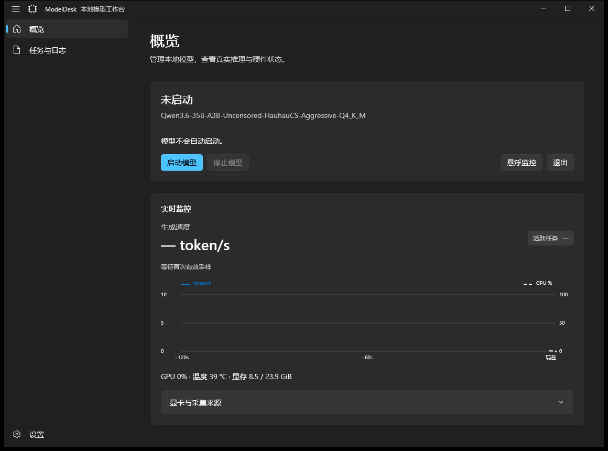
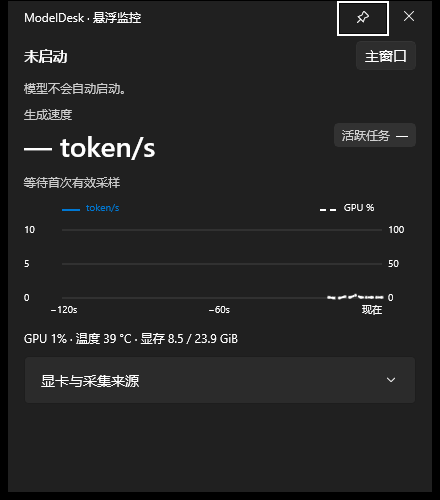
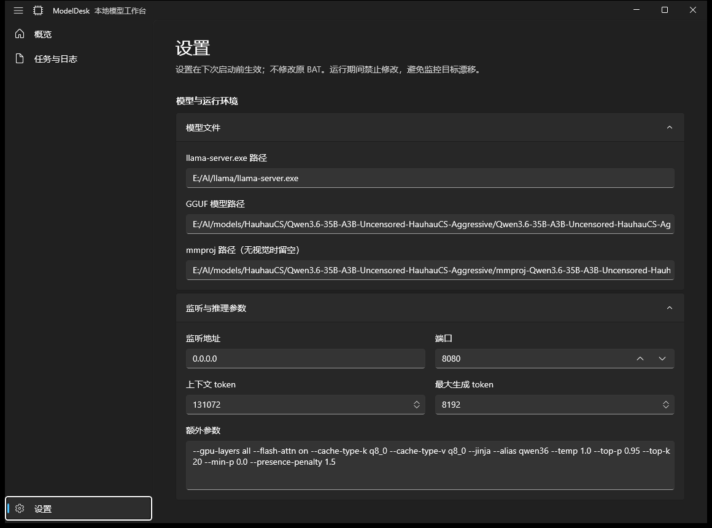
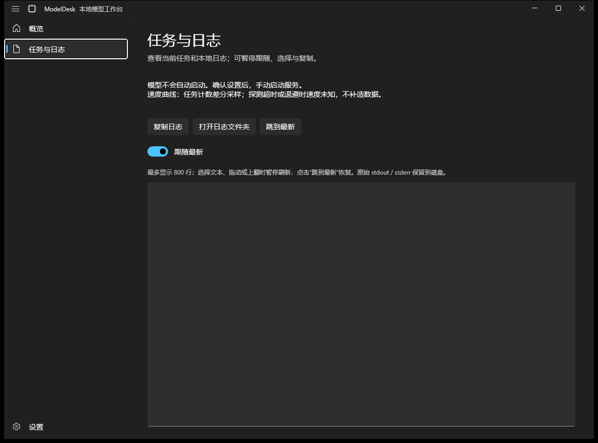

# ModelDesk · 本地模型工作台

一个**原生 WinUI 3** 的本地大模型监控与管理工具，面向运行 `llama.cpp`（`llama-server`）的本地推理工作站。

- **只读连接**本地推理服务（`/health`、`/slots`、`/metrics`），不碰你的原有启动脚本/BAT。
- 可**启动 / 停止**由本程序拉起的模型进程，停止走确认。
- 提供**实时生成速率（token/s）、活跃任务、提示词预处理进度、GPU 利用率/温度/显存**叠加曲线。
- **系统托盘常驻**：关闭主窗口收起到托盘，不退出；从托盘恢复、开关悬浮监控、启停、退出。
- **悬浮监控窗**：独立置顶小窗，可一键取消置顶，方便边干活边看推理状态。

界面壳层基于 **Microsoft WinUI Gallery**（MIT License），遵循 WinUI / Fluent 原生控件与交互规范，非 WPF 换皮。

---

## 界面预览

**概览**（生成速率 / GPU / 曲线 / 启停控制）



**悬浮监控**（独立置顶小窗）



**设置**（模型与运行环境、监听与推理参数）



**任务与日志**



---

## 功能特性

- 概览页：模型状态、生成速度（唯一主速率）、活跃任务、最近采样时间、提示词预处理阶段、GPU 摘要、实时叠加曲线。
- 任务与日志页：实时任务文本与本地日志查看（跟随最新 / 暂停 / 复制 / 打开日志目录）。
- 设置页：模型与运行环境、监听与推理参数、显存与进程安全。
- 悬浮监控：独立置顶窗，与悬浮窗同高风格的系统按钮，可取消置顶。
- GPU 监控：通过驱动 `nvidia-smi` 采集 **NVIDIA GPU0 整卡** 利用率、温度、显存；缺测时明确显示。
- 进程与端口安全：端口被占用时禁止启动；有自有模型运行时禁止退出管理器，避免日志管道中断。

---

## 系统要求

- Windows 10 版本 **19041（20H1）** 或更高。
- 发布形态为 **WinAppSDK 自包含（SelfContained）** 的非 MSIX 便携目录：**无需安装、无需提前安装 .NET 运行时**，双击 `ModelDesk.WinUI3.exe` 即用。
- 本机需有可访问的 `llama-server`（如本地 llama.cpp）才能“启动模型”；不启动模型时程序仅做只读监控。
- GPU 监控依赖 NVIDIA 驱动 `nvidia-smi`；无 NVIDIA 显卡或命令缺失时相关项显示缺测。

---

## 快速开始

### 方式一：便携版（推荐）

1. 获取发布目录（含 `ModelDesk.WinUI3.exe` 与其依赖运行时）。
2. 进入目录，**双击 `ModelDesk.WinUI3.exe`**。
3. 日志与配置文件保存在该 `exe` 同级目录，无需管理员权限。

> 程序**不会自动启动任何模型**。

### 方式二：从源码构建

需要 **.NET 9 SDK** 与 **Windows App SDK 2.5.1**（由 `csproj` 自动还原）。

```bash
dotnet publish ModelDesk.WinUI3.csproj -c Release -p:Platform=x64 -p:PublishSingleFile=false -o ./publish
# 运行
./publish/ModelDesk.WinUI3.exe
```

便携自包含（含运行时）发布：

```bash
dotnet publish ModelDesk.WinUI3.csproj -c Release -p:Platform=x64 `
  -p:WindowsPackageType=None -p:WindowsAppSDKSelfContained=true `
  -p:SelfContained=true -p:PublishSingleFile=false -o ./publish
```

---

## 使用说明

### 1. 配置（设置页）

首次使用前在「设置」中填写：

| 配置项 | 说明 |
| --- | --- |
| `llama-server.exe` 路径 | 你的 llama.cpp 服务端可执行文件绝对路径 |
| GGUF 模型路径 | 模型权重文件绝对路径 |
| mmproj 路径 | 多模态投影文件；无视觉能力时留空 |
| 监听地址 | 如 `127.0.0.1` |
| 端口 | 默认 `8080`，范围 1–65535 |
| 上下文 token | 上下文长度，最小 512 |
| 最大生成 token | 单次最大生成长度 |
| 额外参数 | 其他传给 `llama-server` 的参数（一行，回车不会提交） |
| 启动前请求 ComfyUI 释放显存 | 开启后会卸载 ComfyUI 已加载模型，释放显存给推理 |

设置保存后立即生效（下次手动启动模型时应用），运行期间禁止修改以避免监控目标漂移。配置文件保存在 `exe` 同级。

### 2. 启动 / 停止模型

- 概览页点击「**启动模型**」：程序按配置拉起 `llama-server` 进程树，并开始轮询 `/health`、`/slots`、`/metrics`。
- 点击「**停止模型**」：弹窗确认后，仅停止由本程序启动的进程树；进行中的推理会中断，**外部服务不会被操作**。
- 启动/停止按钮按状态自动可用；运行期间相关设置项禁用。

### 3. 实时监控与悬浮窗

- 「**悬浮监控**」按钮打开独立置顶小窗，显示与主窗一致的速率、GPU 与曲线；点击图钉可取消/恢复置顶。
- 主窗与悬浮窗均显示：生成速度（token/s）、活跃任务、GPU 利用率/温度/显存、叠加曲线。
- 提示词预处理仅在相关阶段显示「已处理 N token」，不出现第二个速率。

### 4. 关闭与托盘

- 关闭主窗口会**收起到系统托盘**，程序继续后台监控。
- 托盘菜单：恢复主窗口、开关悬浮监控、启动、停止、退出。
- 退出时会确认；有自有模型运行时禁止退出，需先停止模型。

---

## 监控指标说明

- **生成速度**：推理阶段每秒生成 token 数，主窗与悬浮窗的唯一主速率。
- **活跃任务**：当前 `/slots` 中的活跃任务数。
- **提示词预处理**：仅在模型处于提示词处理阶段显示进度（如 `14% · 已处理 N token`）。
- **GPU 摘要**：`GPU 名称 · 温度 · 显存`，来自 `nvidia-smi` 的**整卡口径**；命令缺失或读取失败时明确显示缺测。

---

## 进程与端口安全

- 端口被占用时**禁止启动**，避免误杀/冲突。
- 停止模型需要确认；有自有模型运行时**禁止退出管理器**，避免日志管道中断导致诊断信息丢失。
- 仅能停止由本程序启动的模型进程；外部服务（如你手动启动的 llama-server）只读、不被操作。

---

## 目录结构（源码）

```
ModelDesk-WinUI3-20261016/
├── ModelDesk.WinUI3.csproj     # 工程文件（WinAppSDK 2.5.1）
├── MainWindow.xaml(.cs)        # 主窗：概览 / 日志 / 设置 + 系统标题栏
├── FloatingWindow.xaml(.cs)     # 悬浮监控窗（置顶）
├── GalleryTitleBarHelper.cs     # 标题栏与系统主题同步（取自 WinUI Gallery）
├── Models/                     # 数据模型与遥测/快照类型
├── Services/                   # ModelService（启停/轮询）、GpuMonitor（nvidia-smi）
├── app.manifest
└── LICENSE.WinUI-Gallery.txt   # 壳层来源许可（MIT）
```

---

## 构建与验证

- 业务回归与无窗口 UI 验证：`ModelDesk.WinUI3.exe --self-test`、`--validate-ui`（返回 0 表示通过；不访问 HTTP、不启动模型、不操作 GPU）。
- 真实桌面视觉与人工交互（明暗、Acrylic、多 DPI、真实模型起停）需在本机验收。

---

## 许可

- 本程序界面壳层基于 **Microsoft WinUI Gallery**，遵循其 **MIT License**（见 `LICENSE.WinUI-Gallery.txt`）。
- 业务代码以 MIT 许可证发布。
